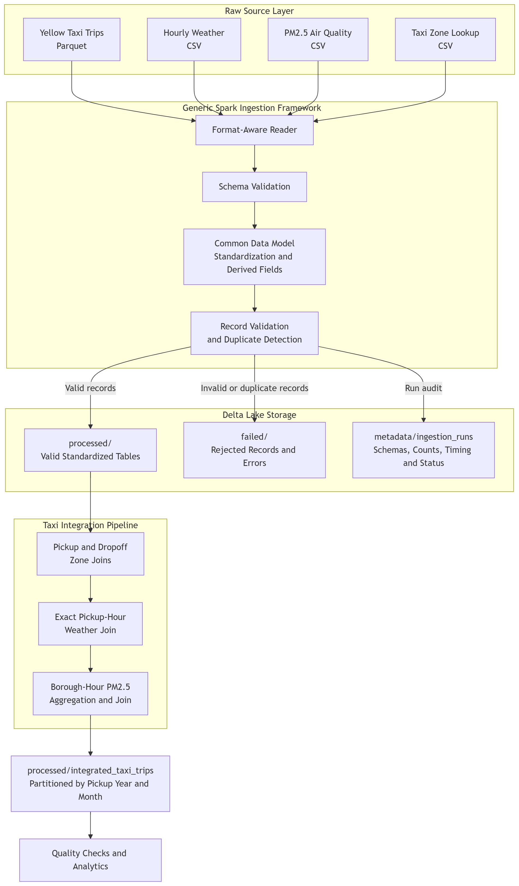

# Data-Intensive Computing — Urban Data Platform

A reusable analytics platform built on Apache Spark and Delta Lake. It ingests
and validates New York City taxi, weather, air-quality, and taxi-zone data;
builds an integrated trip table; runs Spark SQL analytics; benchmarks query
optimizations; supports incremental updates with monitoring and validation; and
feeds a reproducible fare-prediction pipeline.

Course project for ID2221 Data-Intensive Computing at KTH (Fall 2026), by
Yixin Xia, Xinyue Feng, and Hsi-Jui Chang.



## Highlights

| Lab | Finding | Source |
|---|---|---|
| 1 · Partitioning | Partitioning 9.4M trips by borough wrote **87% slower** than by month (22.88 s vs 12.24 s). The gap tracks the single largest group: Manhattan holds 2.4× the rows of the largest month, and the slowest task sets the stage time. | [benchmark report](reports/lab1/benchmark_report.pdf) |
| 2 · Query optimization | Caching **5.86×**, broadcast join **3.57×** (vs. forced shuffle join), partition pruning 1.25×. Apparent AQE gains (up to 1.37×) flipped when the run order was reversed, so they were a measurement artifact, not a real speedup. | [benchmark](reports/lab2/Iab2_benchmark.pdf) |
| 3 · Platform evaluation | Found a time-zone bug in the update generator: 1,385 trips (0.3%) landed on 2024-03-31, which forced all 3.6M March trips to be recomputed (45.0 s vs 35.4 s). Fixed and re-measured. | [evaluation report](reports/lab3/lab3_evaluation_report.pdf), [run log](artifacts/task2_refresh_results.jsonl) |
| 4 · Reproducible ML | Built the same fare-prediction training set from the platform and from raw files (36 re-implemented cleaning checks and 5 joins) and verified the two are identical across rebuilds. | [evaluation report](reports/lab4/lab4_evaluation_report.pdf) |

## What each lab builds

| Lab | Scope | Code | Reports |
|---|---|---|---|
| 1 | Data catalog, ingestion and validation, integrated trip table, partition-strategy benchmark | `notebooks/data_catalog.ipynb`, `ingestion_framework.ipynb`, `integrated_taxi_trips.ipynb`, `benchmark.ipynb` | [design](reports/lab1/design_report.pdf), [benchmark](reports/lab1/benchmark_report.pdf), [data model](reports/lab1/common_data_model.md) |
| 2 | Spark SQL analytics, six reusable Delta data products, query optimization (caching, pruning, broadcast join, AQE) | `notebooks/analytical_queries.ipynb`, [`notebooks/data_products/`](notebooks/data_products/), `notebooks/optimization/` | [report](reports/lab2/lab2_short_report.pdf), [benchmark](reports/lab2/Iab2_benchmark.pdf) |
| 3 | Incremental updates, analytical consistency, monitoring, extensible validation, platform evaluation | `src/data_intensive_computing/task1/` – `task5/`, `notebooks/evaluate.ipynb` | [design](reports/lab3/lab3_design_report.pdf), [evaluation](reports/lab3/lab3_evaluation_report.pdf) |
| 4 | Fare prediction with Spark ML; platform-built vs. raw-built training data; reproducibility checks | `src/data_intensive_computing/week4/`, `notebooks/w4_*.ipynb` | [report](reports/lab4/ID2221_Lab4.pdf), [evaluation](reports/lab4/lab4_evaluation_report.pdf) |

Measured results from every experiment are kept as JSON/JSONL in [`artifacts/`](artifacts/).

## Repository layout

```text
src/data_intensive_computing/   reusable platform code (task1–task5, week4, Spark setup)
notebooks/                      analyses, data products, optimization and ML experiments
artifacts/                      raw measurement logs and run summaries
reports/                        lab design and evaluation reports (PDF)
tools/hadoop/bin/               winutils for running Spark on Windows
docs/RUNNING.md                 full setup and per-task commands
```

## Quick start

Requires Python with [uv](https://docs.astral.sh/uv/) and Java 17 (for PySpark 4.x).

```bash
uv sync
uv run jupyter lab
```

Raw data is not included because the files are too large. Put the NYC TLC
yellow-taxi 2024 Parquet files, `weather.csv`, `hourly_88101_2024.csv`, and
`taxi_zone_lookup.csv` in `data/raw/`.

See [docs/RUNNING.md](docs/RUNNING.md) for Windows setup, the command-line
interface for each task, and the complete execution order.